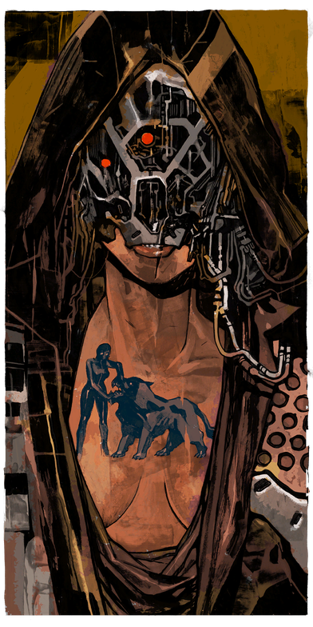
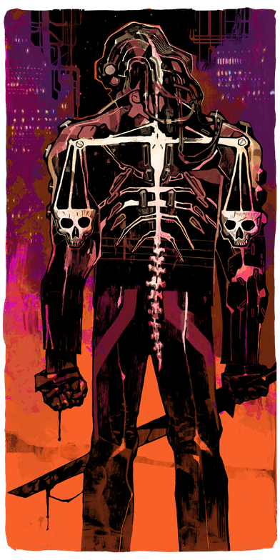
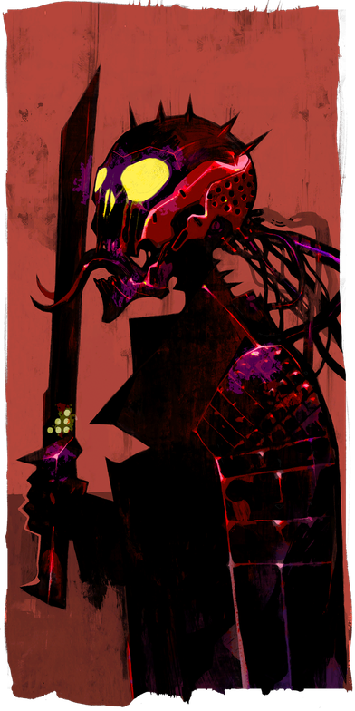
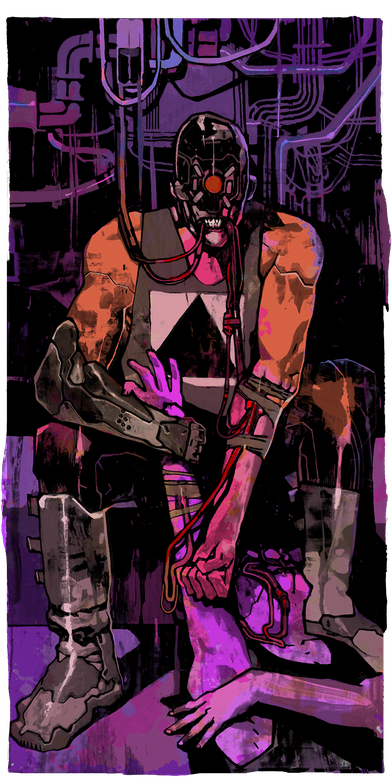
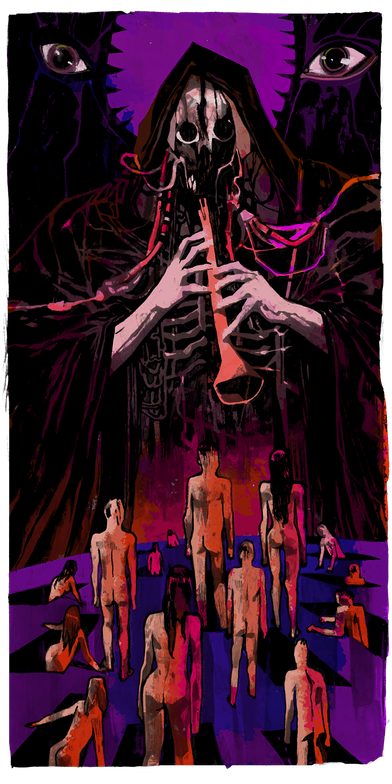

# All cards

A manual test page. It shows each card image with its text, so that you can see that no card is missing.
Edit this page by hand when you add, remove, or rename a card in [`assets/`](assets).

This is an unofficial fan work and is not affiliated with, approved by, or endorsed by CD PROJEKT RED. The card images and texts are © CD PROJEKT S.A. See [NOTICE.md](NOTICE.md).

## Major Arcana

### The Fool

The Fool is everyone - including you and me. Each step he takes on his journey feels like stepping into a brave new world. Ultimately, the journey will change him. But as the card shows, he's a trustworthy lad whose tireless hope drives him toward his goal.

### The Magician

The Magician is the card of self-confidence and adapting to situations through intellect and sheer will. The Magician is a schemer who always has one last trick up his sleeve, who despite everything manages to stay afloat and remain in control of his own destiny.

### The High Priestess

The High Priestess is a card of mystery. It shows how all our secrets hang by a delicate thread and the struggle between common sense and intuition. The High Priestess symbolizes the cold, calm waters as well as the mysteries hidden in their depths.

### The Empress

The empress is a card of femininity and motherhood. She is authoritative, knows what she wants, and exhibits refinement and sensuousness. The Empress symbolizes creativity and growth, and instructs us not to dismiss our unconscious impulses, but to trust our intuition.

### The Emperor

The Emperor represents patriarchal control and is pleased with the authority and power he possesses to shape the future. The Emperor makes the rules and enforces them for the common good. But prestige has its dark sides – the Emperor is dominating and ruthless and will climb over a mountain of bodies to achieve his aim.

### The Hierophant

The Hierophant symbolizes a respect for tradition. It represents one who tries to maintain the established order, even though their very character is shaped by it. The Hierophant places his faith in institutions – for the alternative is pure chaos. Only by placing his faith in order can he draw strength.

### The Lovers

The Lovers is the card of dichotomies. It points to the contradictions that clash within each of us and of the challenge of striking a balance between extremes. The Lovers is also the card of dilemmas, like The Fool who stands at the crossroads, unable to make his choice.

### The Chariot

The Chariot is always charging ahead despite being pulled by its steeds in opposite directions. The rider who steers it constantly reins in the light and dark sides of the soul with the help of Reason. To ride in The Chariot is to experience highs and lows – ups and downs.

### Strength

Strength is the card of resilience. It is associated with determination, bravery and internal struggle. One must have dedication in order to overcome obstacles and reach one's goal. Strength is about physical prowess and spiritual fortitude – the power that must be unleashed to achieve the impossible.

### The Hermit

The Hermit is a card of self-imposed isolation. It represents an escape from the hustle and bustle of the city, a turning away from constant newness toward Ye Olde ways. For the hermit, solitude is the road to the sublime – a road that is taken not with great bounds and strides, but with small, concentrated steps.

### Wheel of Fortune

The Wheel of Fortune means that change is coming. One's destiny could turn out for the better or the worse, yet it also bears the promise of new possibilities. The Wheel reminds us that nobody remains at the top forever, but also that not every situation is hopeless.

### Justice

Justice is the card of conflict resolution. It proclaims the need for order, to see through lies and deceit, and a return to the natural state of affairs. Justice implies a just sentence, but also due process.

### The Hanged Man

The Hanged Man is the card of sacrifice. It says that a price must be paid in order to achieve enlightenment. The Hanged Man's forsakenness opens the path for rebirth into a new life, though this path is wrought with pain suspended in time and ultimately ends in death.

### Death

Death is the card of becoming. It signifies an imminent and difficult transition – the conclusion of one phase of life and the beginning of another. Inevitably, something gets lost during the transformation, but something else will rise and take its place.

### Temperance

Temperance is the card of balance. It may symbolize self-restraint or the gradual shift toward a more mature state of equilibrium. Temperance is associated with being in control of oneself as well as the desire to achieve inner peace.

### The Devil

The Devil is addiction, craving and passion. He brings fame and fortune, but at the price of losing oneself to a world of material distractions. The Devil lures unsuspecting souls into traps, but always grants them a choice. One can try their luck and take him up on his offer, but one should always know when to call quits.

### The Tower

The Tower is an omen of radical change, chaos and destruction. The lightning striking The Tower signifies a return to the old order that lies buried under the ruins, and a new order that will rise from it. It is a symbol of tragedy, apocalypse, and self-destruction.

### The Star

The Star is the card of hope. In the darkest of nights there is a light that shines the path to home. The Star is inspiration, motivation and gives us strength to move forward.

### The Moon

The Moon reminds us that reality is not always what it seems at first glance. In a world of appearances and illusions, the best course is often charted by one's own intuition. The Moon is also the card of dreams, desires, and of course, sleep – Death's nightly ritual.

### The Sun

The Sun symbolizes success. It is a card of freedom, renewal and a bright future that lies ahead. The Sun also represents truth, for its light will always pull back the curtain of shadow that hides the world's secrets. It is also represents greatness and splendor.

### Judgement

Judgement is the card of renewal. The angel blowing into the horn heralds resurrection and liberation. This card foretells an important change that will result in healing or fulfillment. It is also a symbol of self-worth.

### The World

The World lies at the end of The Fool's long and winding journey. Wiser and more world-weary than he started out, the Fool faces a moment of reckoning. Some of us accept where our journey has led us to, while others embark on a new challenge. One thing in this World is certain – you can't have it all.

## Minor Arcana

### Page of Wands

The Page of Wands lives for sparks of inspiration and the promise of new opportunities. Growth is the only constant; change - the only rule. Their journey is messy, imperfect, but always high-spirited. In the craters of ruin they sow all they can, knowing whatever sprouts may be the beginning of something revolutionary.

### Knight of Wands

The Knight of Wands does not wait for permission. The presence of obstacles only proves they're on the right path. Beneath an outward swagger lies a genuine hunger for greatness, and fear takes a back seat when adventure calls. They leap before looking, but even when they fall they never stop moving forward.

### Queen of Wands

The Queen of Wands stands firm when others waver and flee. She is both bulwark and spearhead. Her courage isn't loud, but it echoes with a spirit of independence that endures long after the noise fades. Drawing this card marks a moment when one must protect what matters most.

### King of Wands

The master of planning and unorthodox ideas. An individual who brings people together and radiates inspiration to those they consider friends. However, their enemies will soon find they are an impulsive, devastating force of nature, capable of breaking oaths and crossing any line, just to see their goals achieved.

### Page of Cups

The Page of Cups drifts through the world with open eyes and an open heart. To some, they appear naive; to others, virtuous. This card represents the youthfulness of one's spirit, their hopes, instincts and ideals. Their dreams today will reshape their tomorrow, assuming they survive the arrows of fate.

### Knight of Cups

The Knight of Cups is a seeker with stars in their eyes and a burning fire in their chest. They thrive on taking action, driven not by logic but by longing. This is a card of newfound vision and ideas that stir the soul. When the world shatters their heart, the reckoning may echo violently.

### Queen of Cups

The Queen of Cups is a wellspring of calm. She listens more than she speaks, understands more than she reveals, and sees what others bury deep. In her presence, broken spirits can learn to hope again.

### King of Cups

A King of Cups is a creative and emotionally-driven person. They are strong individuals, who realize the importance of feelings. Intuition helps them navigate their lives. When fate is in their favor, compassion guides their actions. When they're at odds with fate, it'd be unwise to trust them.

### Page of Swords

The Page of Swords never drops their guard. Curious and calculating, their inquisitive and innovative nature defines their trajectory and the fortunes of those around them. This card signifies an approaching beginning that requires careful consideration of all pathways and outcomes. When preparing for anything, one's awareness becomes their armor.

### Knight of Swords

The Knight of Swords is a harbinger of dramatic change. It signifies leaving the comfort of the known world for new ventures without looking back, no matter the risk. It represents one who values honesty and clarity above all else. Their forthright nature can sometimes sting; yet, this aversion to deceit should be considered a gift for friend and foe alike.

### Queen of Swords

The Queen of Swords rules with her razor wit and a tongue that cuts deeper than folded steel. She seeks truth in all things and will not tolerate deceit. This is a card of clear-eyed independence, wisdom, intellect, and an ability to see through illusions. She walks alone, not because she must, but because few can keep her pace and embrace life without the protection of a mask.

### King of Swords

Two things matter above all else for a King of Swords: logic and conviction. They represent a person with a precise moral compass, who is known for their caring demeanor. However, enemies beware - the King of Swords is a ruthless opponent, who will not rest until you are punished and left to be torn apart by hounds of fate.

### Page of Pentacles

For the Page of Pentacles, every horizon is the gateway to a new beginning. They inevitably make mistakes and burn bridges, but never lose faith that they are working toward something better. Drawing this card signals a moment when fear of the future dissipates, revealing a promising plan.

### Knight of Pentacles

When a line is crossed, the Knight of Pentacles is who you want standing at your side. This card represents those who protect what is theirs. The Knight's stubborn nature does not serve the pursuit of new glory or fame, but the safeguarding of legacy. It also symbolizes the preservation of songs written in one's own blood.

### Queen of Pentacles

The Queen of Pentacles lives boldly and wears luxury like a suit of armor. She opens her doors without fear, offering comfort, generosity and connection. She knows what it means to lose oneself and find another standing in their place. This card represents a return to something real.

### King of Pentacles

The King of Pentacles is imperious. They represent enterprise, pragmatism, but also attachment. From such a person one can expect coldness or attachment to material possessions; they are likely to turn your world upside down sooner or later.
