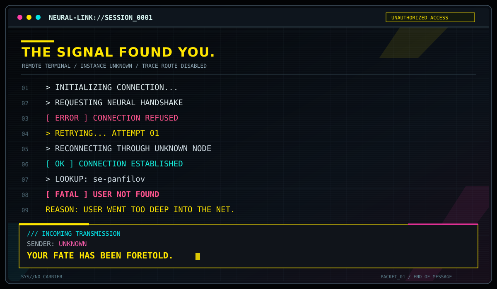

<!-- Generated by `npm run readme` from templates/README.template.md. Do not edit this file. Edit the template. Card: The World -->

---

## Reading for 5 November 2026

  

### The World

> The World lies at the end of The Fool's long and winding journey. Wiser and more world-weary than he started out, the Fool faces a moment of reckoning. Some of us accept where our journey has led us to, while others embark on a new challenge. One thing in this World is certain – you can't have it all.

---

## Legal

This is an unofficial fan work and is not approved/endorsed by CD PROJEKT RED.

The tarot card images and card texts in [`assets/`](assets) come from the game Cyberpunk 2077. They are © CD PROJEKT S.A. All rights reserved. They are used here in a non-commercial fan project under the [CD PROJEKT RED Fan Content Guidelines](https://www.cdprojektred.com/en/fan-content). They are not covered by the MIT license of this repository. See [NOTICE.md](NOTICE.md).

CD PROJEKT, Cyberpunk, and Cyberpunk 2077 are registered trademarks of CD PROJEKT S.A.
